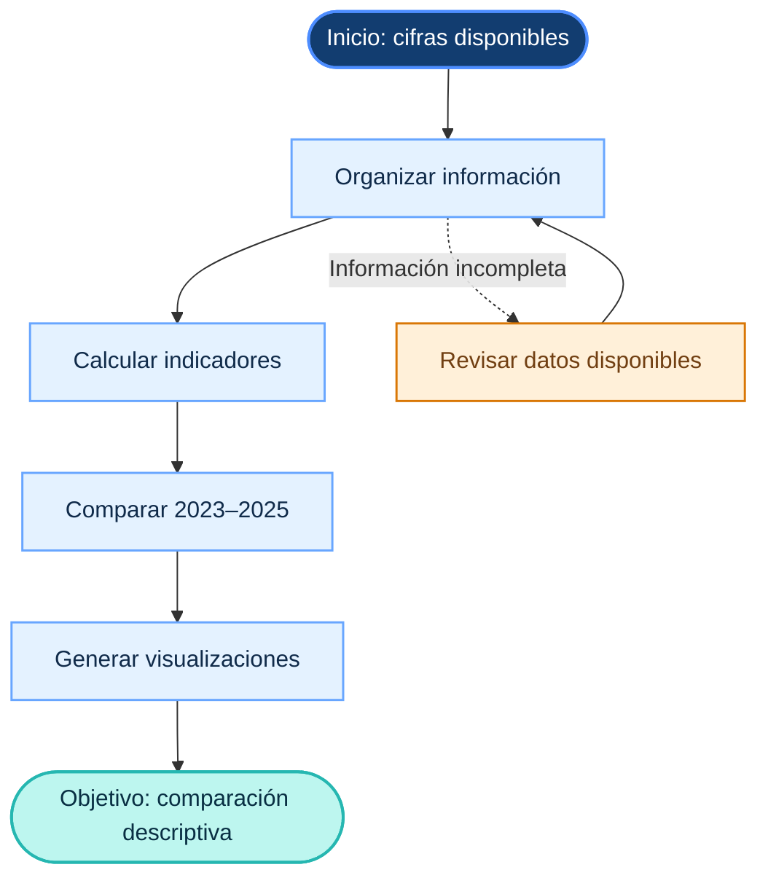
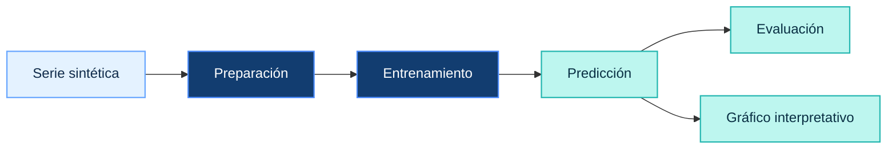

<div align="center">


# 🫁 Análisis de IRAs en menores de 5 años

**Challenge 2 · Fundamentos de Machine Learning · UPCH**

<p>
  
  
  
  
</p>

*Un recorrido por los datos epidemiológicos, los algoritmos de búsqueda y una demostración de aprendizaje supervisado.*

</div>

---

## 📌 Índice

- [Acerca del proyecto](#-acerca-del-proyecto)
- [El caso en cifras](#-el-caso-en-cifras)
- [Objetivos](#-objetivos)
- [Espacio de estados](#-espacio-de-estados)
- [Algoritmos de búsqueda](#-algoritmos-de-búsqueda)
- [Modelo predictivo](#-modelo-predictivo)
- [Tecnologías](#-tecnologías)
- [Cómo ejecutar](#-cómo-ejecutar)
- [Conclusiones y limitaciones](#-conclusiones-y-limitaciones)
- [Referencias](#-referencias)

---

## 🔎 Acerca del proyecto

Este proyecto académico explora el caso de las **Infecciones Respiratorias Agudas (IRAs) en menores de cinco años en el Perú** mediante tres componentes:

| Componente | ¿Qué se realiza? |
|:--|:--|
| 📊 **Análisis descriptivo** | Comparación de episodios de IRA y defunciones por neumonía entre 2023 y 2025. |
| 🧭 **Búsqueda** | Representación de un problema mediante un espacio de estados y comparación de algoritmos. |
| 🧠 **Machine Learning** | Demostración del flujo de regresión lineal con una serie de datos sintéticos. |

### Pregunta orientadora

> ¿Cómo podemos explorar un caso de salud pública mediante datos y métodos computacionales?

El análisis descriptivo, los algoritmos de búsqueda y el modelo predictivo tienen propósitos distintos. Se presentan como ejercicios académicos y **no constituyen un sistema clínico ni un modelo epidemiológico validado**.

---

## 📊 El caso en cifras

Las siguientes cifras corresponden a la infografía proporcionada para el caso académico.

| Indicador | 2023 | 2024 | 2025 |
|:--|--:|--:|--:|
| Episodios de IRA | 1 003 178 | 883 959 | 824 978 |
| Defunciones por neumonía | 113 | 82 | 51 |

### ¿Qué muestran los datos?

- Los episodios de IRA disminuyen en los tres años presentados.
- Las defunciones por neumonía también disminuyen durante el periodo.
- Esta comparación describe una variación temporal, pero **no permite identificar sus causas ni demostrar el efecto de una intervención**.

---

## 🎯 Objetivos

### Objetivo general

Explorar el caso de las IRAs en menores de cinco años mediante visualización de datos, algoritmos de búsqueda y una demostración de regresión lineal, identificando los alcances y las limitaciones de cada técnica.

### Objetivos específicos

1. Comparar los indicadores epidemiológicos disponibles para 2023, 2024 y 2025.
2. Representar un problema mediante estados, transiciones, operadores y restricciones.
3. Implementar y comparar BFS, DFS, fuerza bruta y A*.
4. Demostrar Hill Climbing como método independiente de optimización local.
5. Entrenar y evaluar una regresión lineal con una serie sintética.
6. Interpretar los resultados y distinguir las demostraciones computacionales de las conclusiones epidemiológicas.

---

## 🕸️ Espacio de estados

El espacio de estados representa las etapas computacionales del análisis. Cada nodo describe una situación del proceso y cada transición representa una operación permitida. **No representa la evolución clínica de una infección ni un protocolo sanitario.**

### Definición del problema

| Elemento | Descripción |
|:--|:--|
| **Estado inicial** | Cifras epidemiológicas disponibles en el material del caso. |
| **Estados intermedios** | Información organizada, indicadores calculados y cifras comparadas. |
| **Estado objetivo** | Obtener una comparación descriptiva de los indicadores de 2023, 2024 y 2025. |
| **Operadores** | Organizar datos, calcular variaciones, comparar indicadores y generar visualizaciones. |
| **Restricciones** | Conservar las unidades, utilizar solo los datos disponibles y evitar inferencias causales. |
| **Criterio de finalización** | Los indicadores están comparados y las limitaciones del análisis están documentadas. |

### Flujo conceptual



> **Nota:** este flujo conceptual describe el proceso de análisis. El grafo específico que recorren los algoritmos debe revisarse en el notebook, junto con sus transiciones y costos.

---

## 🔍 Algoritmos de búsqueda

El proyecto aborda distintas estrategias de exploración para estudiar cómo se recorre un espacio de estados.

| Algoritmo | Estrategia | ¿Qué permite observar? |
|:--|:--|:--|
| **BFS** | Explora por niveles. | Encuentra un camino con el menor número de aristas cuando todas tienen el mismo costo. |
| **DFS** | Profundiza en una rama antes de retroceder. | Permite observar una exploración en profundidad. |
| **Fuerza bruta** | Examina las alternativas definidas. | Puede servir como referencia si la exploración es exhaustiva. |
| **A\*** | Combina costo acumulado y heurística. | Prioriza estados según el costo y la heurística implementados. |
| **Hill Climbing** | Mejora local iterativa. | Ilustra la búsqueda de mejoras a partir de una solución actual. |

Los costos utilizados en el ejercicio son **didácticos** y no representan costos sanitarios reales. Hill Climbing se presenta como una demostración independiente de optimización local.

### Resultados de la búsqueda

Los resultados deben obtenerse al ejecutar el notebook. Registra aquí las salidas reales de cada algoritmo; no completes la tabla con valores estimados.

| Algoritmo | Camino encontrado | Costo total | Nodos explorados |
|:--|:--|--:|--:|
| BFS | Registrar salida del notebook | — | — |
| DFS | Registrar salida del notebook | — | — |
| Fuerza bruta | Registrar salida del notebook | — | — |
| A* | Registrar salida del notebook | — | — |

**Interpretación:** compara los caminos, costos y nodos explorados según las condiciones de tu grafo. No declares un algoritmo como ganador sin considerar los costos, las restricciones y el criterio de comparación.

---

## 🧠 Modelo predictivo

La regresión lineal se utiliza para demostrar el flujo básico del aprendizaje supervisado: preparación de datos, entrenamiento, predicción y evaluación.



### Métricas de evaluación

| Métrica | ¿Qué mide? | Interpretación general |
|:--|:--|:--|
| **MAE** | Promedio del error absoluto. | Menor valor significa menor error absoluto medio en la escala de la variable objetivo. |
| **RMSE** | Raíz del error cuadrático medio. | Penaliza relativamente más los errores grandes. |
| **R²** | Desempeño respecto a una referencia basada en la media. | Puede ser negativo si el modelo rinde peor que dicha referencia. |

Añade a esta sección los valores de MAE, RMSE y R² obtenidos en la ejecución actual del notebook, junto con el gráfico generado. Las métricas describen el comportamiento del modelo sobre la serie utilizada; por sí solas no demuestran capacidad predictiva sobre casos reales.

> **Limitación principal:** la serie es sintética. El modelo no predice casos reales de IRA ni defunciones por neumonía en el Perú. Para estudiar capacidad predictiva epidemiológica se necesitan datos observados, una fuente documentada y una validación adecuada con datos independientes.

---

## 🧰 Tecnologías

| Herramienta | Uso |
|:--|:--|
| **Python + Google Colab** | Desarrollo y ejecución del notebook. |
| **NumPy** | Operaciones numéricas y datos sintéticos. |
| **scikit-learn** | Regresión lineal y métricas de evaluación. |
| **Matplotlib** | Gráficos y visualización de resultados. |
| **NetworkX** | Representación y análisis de grafos. |
| **React + TypeScript + Vite** | Interfaz web del proyecto. |
| **Tailwind CSS** | Estilos de la interfaz. |
| **GitHub Pages + Actions** | Publicación y despliegue de la web. |

---

## ▶️ Cómo ejecutar

### Notebook de Google Colab

1. Abre el [notebook del proyecto](https://drive.google.com/file/d/1-4engxnSvRuyiOzl_RCPbHVmmpszVMm9/view?usp=sharing).
2. Selecciona **Entorno de ejecución → Ejecutar todas**.
3. Comprueba las salidas, los gráficos, las métricas y los resultados de búsqueda.

### Aplicación web

Desde la carpeta del proyecto, ejecuta:

```bash
npm install
npm run dev
```

Abre en el navegador la dirección local que indique la terminal.

### 🌐 Ver presentación web

<div align="center">

[](https://clxnode.github.io/challenge-2-analisis-iras-peru/)

</div>

---

## ✅ Conclusiones y limitaciones

- Las cifras disponibles muestran una disminución de los episodios de IRA y las defunciones por neumonía entre 2023 y 2025.
- La comparación descriptiva no identifica las causas de esas variaciones.
- Los algoritmos de búsqueda permiten estudiar distintas estrategias de exploración de estados.
- Hill Climbing ilustra una estrategia independiente de optimización local.
- La regresión lineal demuestra el flujo de entrenamiento y evaluación sobre datos sintéticos.
- Los costos y las transiciones del grafo son didácticos; no representan un protocolo ni costos sanitarios reales.

> **Idea clave:** todo resultado computacional debe interpretarse de acuerdo con los datos, los supuestos y el método que lo sustentan.

---

## 📚 Referencias

1. **Material del caso:** infografía de IRAs proporcionada para el trabajo académico. Completar con el título exacto, entidad responsable y enlace original si aparecen en el documento.
2. **Materiales de clase de la UPCH:** sesiones 3–7 sobre búsqueda, tipos de aprendizaje y regresión.
3. [Google Colab](https://colab.research.google.com/) — entorno para ejecutar notebooks.
4. [Documentación de scikit-learn](https://scikit-learn.org/stable/) — modelos y métricas de Machine Learning.
5. [Documentación de GitHub Pages](https://docs.github.com/pages) — publicación de sitios web.

---

<div align="center">


**IRAs Perú · Data Lab**  
*Challenge 2 · Fundamentos de Machine Learning · Universidad Peruana Cayetano Heredia*

<sub>Proyecto académico. Las cifras epidemiológicas proceden del material del caso y los datos sintéticos se identifican como tales.</sub>

</div>
