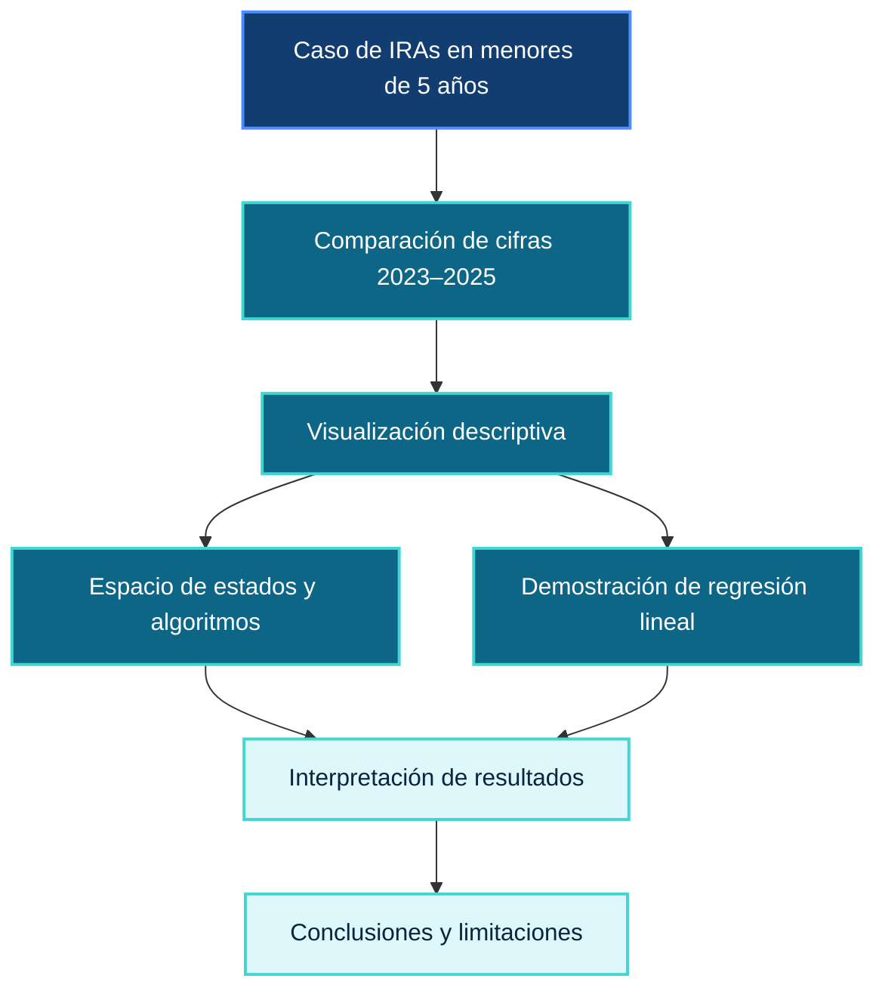
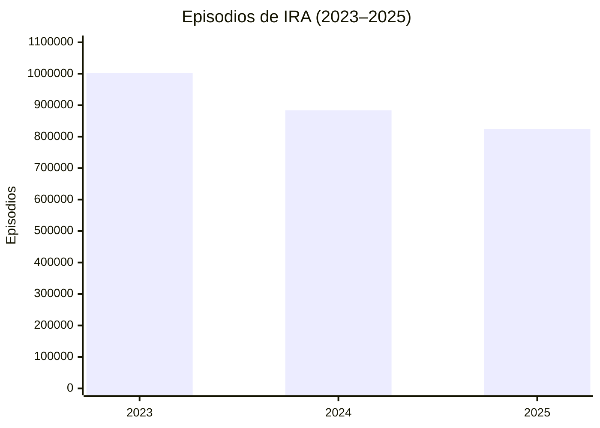
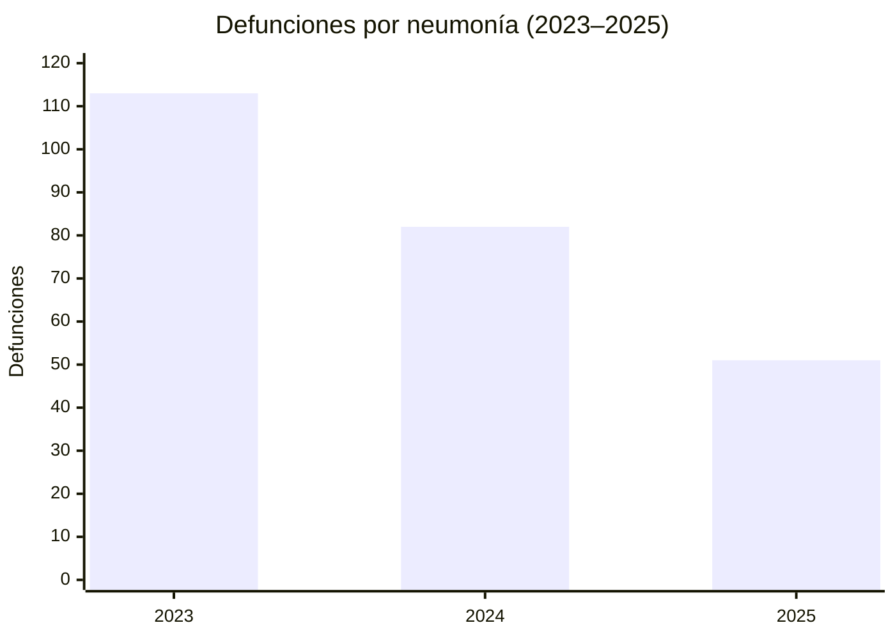
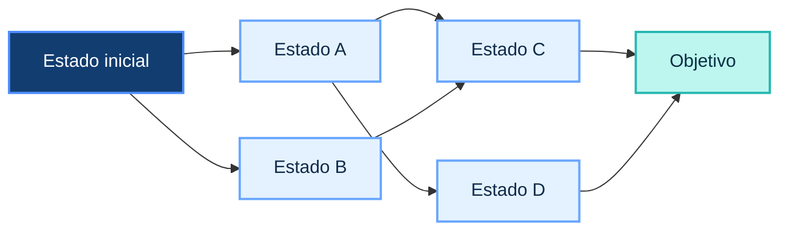
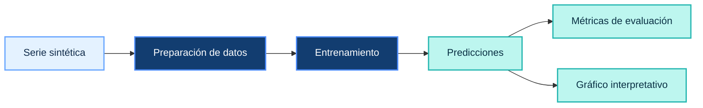

<p align="center">
  
</p>

<p align="center">
  <strong>Exploración de las Infecciones Respiratorias Agudas en menores de 5 años</strong>
  <br/>
  <sub>Datos epidemiológicos · Algoritmos de búsqueda · Regresión lineal</sub>
</p>

<p align="center">
  
  
  
  
  
  
</p>

<p align="center">
  <sub>Universidad Peruana Cayetano Heredia · Challenge 2 · Proyecto académico</sub>
</p>

---

## 🧭 Navegación

- [Sobre el proyecto](#-sobre-el-proyecto)
- [El problema y los datos](#-el-problema)
- [Objetivos](#-objetivos)
- [Espacio de estados y búsqueda](#-espacio-de-estados)
- [Regresión lineal](#-demostración-de-regresión-lineal)
- [Herramientas](#-herramientas-utilizadas)
- [Conclusiones y limitaciones](#-conclusiones-y-limitaciones)
- [Cómo ejecutar](#-cómo-ejecutar)
- [Referencias](#-referencias)

---

# 🔷 Sobre el proyecto

<div align="center">

| **Tema** | **Enfoque** | **Propósito** |
|:---:|:---:|:---:|
| IRAs en menores de 5 años | Epidemiología + búsqueda + ML | Explorar datos y demostrar métodos computacionales |

</div>

Este proyecto corresponde al **Challenge 2 del curso Fundamentos de Machine Learning** de la **Universidad Peruana Cayetano Heredia (UPCH)**. Combina el análisis descriptivo de cifras epidemiológicas de las Infecciones Respiratorias Agudas (IRAs) en menores de cinco años en el Perú con algoritmos de búsqueda y una demostración académica de regresión lineal.

<p align="center">

### DATOS → REPRESENTACIÓN → BÚSQUEDA → APRENDIZAJE → INTERPRETACIÓN

</p>

La pregunta que orienta el trabajo es:

<div align="center">

## ¿Cómo podemos explorar un caso de salud pública mediante datos y métodos computacionales?

</div>

---

## 🩺 El problema

Las Infecciones Respiratorias Agudas en menores de cinco años son el tema de análisis del proyecto. Se comparan los episodios de IRA y las defunciones por neumonía reportadas en la infografía proporcionada para los años 2023, 2024 y 2025.

> **Punto clave:** observar una disminución en las cifras no permite establecer, por sí sola, las causas que la produjeron.

El trabajo aborda el caso desde una perspectiva académica: los datos epidemiológicos se utilizan para la comparación descriptiva, mientras que los algoritmos de búsqueda y la regresión lineal ilustran técnicas computacionales. Estos componentes no constituyen un sistema clínico ni un modelo epidemiológico validado.



<p align="center">
  
</p>

## 📊 El caso en números

<div align="center">

| **Indicador** | **2023** | **2024** | **2025** |
|:---|---:|---:|---:|
| Episodios de IRA | 1 003 178 | 883 959 | 824 978 |
| Defunciones por neumonía | 113 | 82 | 51 |

</div>

Las cifras proceden de la infografía proporcionada para el caso.





<div align="center">

> **Lectura descriptiva:** los dos indicadores disminuyen durante el periodo mostrado. Esta comparación no identifica causas ni demuestra el efecto de una intervención específica.

</div>

---

## 🎯 Objetivos

<p align="center">

**REPRESENTAR → EXPLORAR → COMPARAR → EVALUAR → INTERPRETAR**

</p>

## Objetivo general

Explorar el caso de las IRAs en menores de cinco años en el Perú mediante visualización de datos, algoritmos de búsqueda y una demostración de regresión lineal, identificando los alcances y las limitaciones de cada técnica.

## Objetivos específicos

1. **Comparar** los episodios de IRA y las defunciones por neumonía entre 2023 y 2025.
2. **Representar** un problema académico mediante un espacio de estados, transiciones, restricciones y un objetivo.
3. **Implementar** BFS, DFS, fuerza bruta y A* para comparar estrategias de búsqueda.
4. **Demostrar** Hill Climbing como método de optimización independiente.
5. **Entrenar y evaluar** una regresión lineal con una serie sintética.
6. **Presentar** los resultados mediante gráficos y una interfaz web.
7. **Distinguir** los resultados didácticos de las conclusiones respaldadas por datos epidemiológicos.

<p align="center">
  
</p>

## 🕸️ Espacio de estados

Un espacio de estados representa situaciones posibles y las transiciones permitidas entre ellas. Los algoritmos de búsqueda exploran ese grafo para encontrar un camino hacia un objetivo según las reglas definidas.

<div align="center">

### Estado inicial → Transiciones válidas → Estado objetivo

</div>



El diagrama anterior es **conceptual**. El grafo concreto, sus restricciones y sus costos corresponden a la implementación académica del notebook; no constituyen un protocolo oficial del Ministerio de Salud del Perú (MINSA).

---

## 🔎 Algoritmos de búsqueda

El proyecto compara distintas estrategias para explorar el espacio de estados.

| **Algoritmo** | **Enfoque** | **Qué permite estudiar** |
|:---|:---|:---|
| **BFS** | Búsqueda en anchura | Explora el grafo por niveles. |
| **DFS** | Búsqueda en profundidad | Profundiza en una rama antes de retroceder. |
| **Fuerza bruta** | Explora las alternativas definidas | Sirve como referencia para comparar soluciones. |
| **A\*** | Búsqueda informada con costos y heurística | Prioriza estados según el criterio implementado. |
| **Hill Climbing** | Optimización local | Ilustra la mejora iterativa de una solución. |

<p align="center">

`EXPLORAR` &nbsp; → &nbsp; `ENCONTRAR RUTAS` &nbsp; → &nbsp; `COMPARAR`

</p>

Los costos utilizados por A* son **didácticos** y no representan costos sanitarios reales. Hill Climbing se presenta como una demostración independiente de optimización local.

<p align="center">
  
</p>

## 🧠 Demostración de regresión lineal

La regresión lineal permite ilustrar el flujo fundamental de un modelo supervisado: preparar los datos, entrenar el modelo, generar predicciones y evaluar sus resultados.

<div align="center">

| **01 · Datos** | **02 · Entrenamiento** | **03 · Predicción** | **04 · Evaluación** |
|:---:|:---:|:---:|:---:|
| Serie sintética | Ajuste del modelo | Valores estimados | Métricas y gráficos |

</div>



> **Importante:** la serie utilizada es sintética. El modelo no predice casos reales de IRA ni defunciones por neumonía en el Perú.

---

## 🧰 Herramientas utilizadas

<div align="center">

| **Herramienta** | **Uso en el proyecto** |
|:---|:---|
| **Google Colab + Python** | Ejecución del notebook y los algoritmos. |
| **NumPy** | Operaciones numéricas y datos sintéticos. |
| **scikit-learn** | Regresión lineal y métricas de evaluación. |
| **Matplotlib** | Gráficos y visualización de resultados. |
| **NetworkX** | Representación y análisis del grafo. |
| **React + TypeScript + Vite** | Presentación web interactiva. |
| **Tailwind CSS** | Estilos de la interfaz. |
| **GitHub Pages + Actions** | Publicación y despliegue de la web. |

</div>

<p align="center">
  
  
  
  
  
</p>

<p align="center">
  
</p>

## 💡 Conclusiones y limitaciones

- Las cifras de la infografía muestran una disminución de los episodios de IRA y de las defunciones por neumonía entre 2023 y 2025.
- La comparación descriptiva no permite determinar las causas de los cambios observados.
- Los algoritmos de búsqueda permiten comparar estrategias para explorar un espacio de estados.
- Hill Climbing ilustra un enfoque independiente de optimización local.
- La regresión lineal demuestra el flujo de entrenamiento y evaluación con datos sintéticos.
- El grafo y los costos utilizados son didácticos; no constituyen un protocolo oficial ni costos sanitarios reales.

<div align="center">

> **Idea clave:** un resultado computacional debe interpretarse según los datos y el método que lo sustentan.

</div>

---

## ▶️ Cómo ejecutar

## Notebook de Google Colab

1. Abrir el [notebook del proyecto en Google Colab](https://drive.google.com/file/d/1-4engxnSvRuyiOzl_RCPbHVmmpszVMm9/view?usp=sharing).
2. Seleccionar **Entorno de ejecución → Ejecutar todas**.
3. Revisar las salidas, los gráficos y las comparaciones generadas.

## Página web (React + Vite)

Desde la carpeta del proyecto, ejecutar:

```bash
npm install
npm run dev
```

Abrir en el navegador la dirección local que indique la terminal.

## 🌐 Acceso al proyecto

<div align="center">

[](https://clxnode.github.io/challenge-2-analisis-iras-peru/)

</div>

---

## 📚 Referencias

1. Infografía del caso de IRAs proporcionada para el Challenge 1.
2. Materiales de clase de la UPCH: sesiones 3–7, sobre búsqueda, tipos de aprendizaje y regresión.
3. [Google Colab](https://colab.research.google.com/) · Entorno para ejecutar notebooks.
4. [scikit-learn](https://scikit-learn.org/stable/) · Documentación de herramientas de Machine Learning.
5. [GitHub Pages](https://docs.github.com/pages) · Documentación para publicar sitios web.

---

<p align="center">
  
</p>

<p align="center">
  <strong>IRAs Perú · Data Lab</strong>
  <br/>
  <sub>Challenge 2 · Fundamentos de Machine Learning · Universidad Peruana Cayetano Heredia</sub>
  <br/>
  <sub>Proyecto académico. Las cifras epidemiológicas proceden de la infografía proporcionada y los datos sintéticos se identifican como tales.</sub>
</p>
