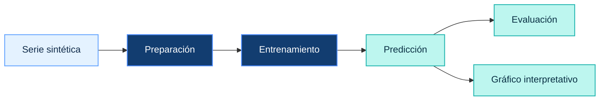

 

# Análisis de IRAs en menores de 5 años

**Challenge 2 · Fundamentos de Machine Learning · Universidad Peruana Cayetano Heredia**

  
  
  
  

Análisis de indicadores epidemiológicos, exploración de espacios de estados y aplicación de algoritmos de búsqueda y regresión lineal a un caso de salud pública.

---

## Acceso al proyecto

Este repositorio reúne la documentación, la implementación de los algoritmos y una página web para presentar los resultados del análisis. Puedes revisar el proyecto desde los siguientes enlaces.

| Recurso | Contenido |
|---|---|
| Página web | Presentación del problema, espacio de estados, algoritmos de búsqueda, modelo predictivo y conclusiones. |
| Notebook de Google Colab | Código Python, ejecución de los algoritmos, entrenamiento de la regresión lineal y evaluación de resultados. |

---

## Índice

- [Acerca del proyecto](#acerca-del-proyecto)
- [El caso en cifras](#el-caso-en-cifras)
- [Objetivos](#objetivos)
- [Espacio de estados](#espacio-de-estados)
- [Algoritmos de búsqueda](#algoritmos-de-búsqueda)
- [Modelo predictivo](#modelo-predictivo)
- [Tecnologías](#tecnologías)
- [Conclusiones y limitaciones](#conclusiones-y-limitaciones)
- [Revisión de los criterios de la rúbrica](#revisión-de-los-criterios-de-la-rúbrica)
- [Referencias](#referencias)

---

## Acerca del proyecto

Este proyecto académico aborda el caso de las **infecciones respiratorias agudas (IRAs) en menores de cinco años en el Perú**. A partir de la información epidemiológica proporcionada para el trabajo, se desarrolla un análisis descriptivo y se aplican conceptos de búsqueda y aprendizaje automático.

El trabajo se organiza en tres componentes:

| Componente | Desarrollo |
|---|---|
| Análisis descriptivo | Comparación de episodios de IRA y defunciones por neumonía entre 2023 y 2025. |
| Algoritmos de búsqueda | Definición de un espacio de estados y comparación de distintas estrategias de exploración. |
| Machine Learning | Entrenamiento y evaluación de una regresión lineal con una serie de datos sintéticos. |

### Pregunta orientadora

¿Cómo podemos analizar un caso de salud pública mediante datos y métodos computacionales, considerando las posibilidades y limitaciones de cada técnica?

Los tres componentes tienen propósitos diferentes. El ejercicio de búsqueda permite estudiar el recorrido por un grafo, mientras que la regresión lineal demuestra un proceso básico de aprendizaje supervisado. Ninguno constituye un sistema clínico ni un modelo epidemiológico validado.

---

## El caso en cifras

Los siguientes valores se transcriben de la infografía proporcionada para el caso académico.

| Indicador | 2023 | 2024 | 2025 |
|---|---:|---:|---:|
| Episodios de IRA | 1 003 178 | 883 959 | 824 978 |
| Defunciones por neumonía | 113 | 82 | 51 |

### Interpretación descriptiva

- Los episodios de IRA disminuyen durante los tres años presentados.
- Las defunciones por neumonía también muestran una reducción en el periodo analizado.
- Estos datos permiten describir una variación temporal, pero no identificar sus causas ni demostrar que una intervención específica haya producido esos cambios.

Las cifras se utilizan como contexto del problema y no como conjunto de entrenamiento del modelo predictivo.

---

## Objetivos

### Objetivo general

Analizar el caso de las IRAs en menores de cinco años mediante herramientas de análisis de datos, algoritmos de búsqueda y una demostración de regresión lineal, identificando los alcances y las limitaciones de cada técnica.

### Objetivos específicos

1. Comparar los indicadores epidemiológicos disponibles para 2023, 2024 y 2025.
2. Representar un problema mediante estados, transiciones, operadores y restricciones.
3. Implementar y comparar BFS, DFS, fuerza bruta y A*.
4. Mostrar el funcionamiento de Hill Climbing mediante un ejemplo independiente.
5. Entrenar y evaluar una regresión lineal con datos sintéticos.
6. Interpretar los resultados sin confundir las demostraciones computacionales con conclusiones epidemiológicas.

---

## Espacio de estados

El espacio de estados representa las etapas computacionales del análisis. Cada nodo describe una situación del proceso y cada transición representa una operación permitida. No representa la evolución clínica de una infección ni un protocolo sanitario.

### Definición del problema

| Elemento | Descripción |
|---|---|
| Estado inicial | Cifras epidemiológicas disponibles en el material del caso. |
| Estados intermedios | Información organizada, indicadores calculados y cifras comparadas. |
| Estado objetivo | Obtener una comparación descriptiva de los indicadores de 2023, 2024 y 2025. |
| Operadores | Organizar datos, calcular variaciones, comparar indicadores y generar visualizaciones. |
| Restricciones | Conservar las unidades, utilizar los datos disponibles y evitar inferencias causales. |
| Criterio de finalización | Los indicadores están comparados y las limitaciones del análisis están documentadas. |

### Flujo conceptual

Este diagrama resume el proceso conceptual de análisis. El grafo específico utilizado por los algoritmos se encuentra desarrollado en el notebook, donde se definen las transiciones y los costos didácticos.

---

## Algoritmos de búsqueda

El proyecto implementa distintas estrategias para explorar un espacio de estados y observar cómo cambia el recorrido según el algoritmo utilizado.

| Algoritmo | Estrategia | Característica principal |
|---|---|---|
| BFS | Búsqueda en anchura | Explora por niveles y encuentra una ruta con el menor número de aristas en un grafo no ponderado. |
| DFS | Búsqueda en profundidad | Explora una rama antes de retroceder; el resultado depende del orden de los vecinos. |
| Fuerza bruta | Exploración exhaustiva | Enumera las rutas simples definidas en el grafo. |
| A* | Búsqueda informada | Prioriza estados mediante el costo acumulado y una heurística. |
| Hill Climbing | Optimización local | Mejora una solución mediante cambios sucesivos que favorecen la función objetivo. |

Los costos utilizados son didácticos y no representan costos sanitarios reales. Hill Climbing se presenta como una demostración independiente de optimización local.

### Resultados de la búsqueda

La siguiente tabla resume los resultados documentados en la ejecución del notebook.

| Algoritmo | Camino o resultado | Transiciones o costo | Resultado de exploración |
|---|---|---:|---|
| BFS | Episodios IRA → Integración → Resumen | 3 transiciones | 6 estados explorados |
| DFS | Episodios IRA → Integración → Resumen | 3 transiciones | 4 estados explorados |
| Fuerza bruta | Enumera rutas por episodios, defunciones y brechas | 3 transiciones por ruta | 3 rutas simples enumeradas |
| A* | Defunciones → Integración → Resumen | 4 unidades didácticas | 4 estados explorados |

BFS y DFS pueden devolver la misma ruta cuando se utiliza el orden de vecinos definido en la implementación actual. La salida de DFS puede cambiar si se modifica ese orden. Fuerza bruta enumera las rutas definidas y no calcula costos, mientras que A* utiliza los costos didácticos establecidos en el código.

Por ello, la comparación debe considerar el criterio utilizado por cada algoritmo y no declarar un ganador sin una métrica común.

---

## Modelo predictivo

La regresión lineal se utiliza para demostrar el flujo básico del aprendizaje supervisado: preparación de datos, entrenamiento, predicción y evaluación.

### Flujo del modelo

### Preparación de los datos

La serie utilizada contiene 36 registros sintéticos. Se emplean los primeros 27 meses para entrenar el modelo y los últimos 9 para evaluar sus predicciones.

Los valores son artificiales y se generan con fines académicos. La tendencia descendente se inspira únicamente en la dirección general de las cifras de la infografía; no corresponde a una serie mensual oficial de IRAs.

### Métricas de evaluación

| Métrica | ¿Qué mide? | Interpretación |
|---|---|---|
| MAE | Promedio del error absoluto. | Indica cuánto se desvían, en promedio, las estimaciones respecto a los valores observados. |
| RMSE | Raíz del error cuadrático medio. | Da relativamente más peso a los errores grandes. |
| R² | Desempeño respecto a una referencia basada en la media. | Permite comparar el ajuste del modelo con esa referencia en el conjunto evaluado. |

La ejecución documentada del notebook obtuvo los siguientes resultados:

| Métrica | Resultado |
|---|---:|
| MAE | 1.40 |
| RMSE | 1.75 |
| R² | 0.602 |

Estas métricas describen únicamente el comportamiento de la regresión sobre la serie sintética utilizada. No representan la precisión de un pronóstico sanitario ni demuestran capacidad predictiva sobre casos reales.

### Interpretación y limitaciones

La pendiente negativa de la recta representa una disminución en la variable sintética a medida que avanza el índice temporal. No debe interpretarse como una tasa observada de reducción de las IRAs.

Para desarrollar y evaluar un modelo epidemiológico sería necesario contar con datos reales, suficientes y documentados, además de una estrategia de validación independiente.

---

## Tecnologías

| Herramienta | Uso |
|---|---|
| Python y Google Colab | Desarrollo y ejecución del notebook. |
| NumPy | Operaciones numéricas y generación de datos sintéticos. |
| scikit-learn | Regresión lineal y métricas de evaluación. |
| Matplotlib | Gráficos y visualización de resultados. |
| NetworkX | Representación y análisis de grafos. |
| React, TypeScript y Vite | Desarrollo de la interfaz web. |
| Tailwind CSS | Estilos de la interfaz. |
| GitHub Pages y GitHub Actions | Publicación y despliegue de la página web. |

---

## Conclusiones y limitaciones

- Las cifras disponibles muestran una disminución de los episodios de IRA y las defunciones por neumonía entre 2023 y 2025.
- La comparación descriptiva no permite identificar las causas de esas variaciones.
- Los algoritmos de búsqueda permiten estudiar distintas estrategias de exploración de estados.
- Hill Climbing muestra el funcionamiento de una estrategia independiente de optimización local.
- La regresión lineal permite demostrar las etapas de entrenamiento, predicción y evaluación utilizando datos sintéticos.
- Los costos y las transiciones del grafo son didácticos; no representan un protocolo ni costos sanitarios reales.

Los resultados deben interpretarse de acuerdo con los datos disponibles, los supuestos utilizados y el método aplicado.

---

## Revisión de los criterios de la rúbrica

| Criterio | Evidencia en el proyecto | Alcance o pendiente |
|---|---|---|
| Presentación del problema | El notebook plantea la pregunta, justifica el uso de búsqueda y regresión y presenta los indicadores de la infografía. | Completar la referencia original de la fuente epidemiológica si se dispone de ella. |
| Espacio de estados | Define estados inicial y objetivo, operadores, restricciones y representación gráfica. | El modelo representa un proceso de análisis, no un proceso clínico. |
| Algoritmos de búsqueda | Implementa BFS, DFS, fuerza bruta, A* y una demostración independiente de Hill Climbing. | Los costos son didácticos y las rutas dependen de la implementación. |
| Modelo predictivo | Desarrolla regresión lineal con 36 registros sintéticos, partición temporal 27/9, visualización y métricas. | No constituye un modelo epidemiológico ni un pronóstico real. |

### Consistencia entre la documentación y el notebook

- BFS y DFS informan transiciones y estados explorados; el costo didáctico se utiliza para A*.
- Fuerza bruta enumera tres rutas simples y no calcula costos.
- Los resultados de la búsqueda deben coincidir con las salidas del notebook.
- Las métricas del modelo deben actualizarse si cambia el código, la semilla o la ejecución.

---

## Referencias

1. **Material del caso:** infografía de IRAs proporcionada para el trabajo académico. Completar con el título exacto, la entidad responsable y el enlace original si están disponibles.
2. **Materiales de clase de la UPCH:** sesiones 3–7 sobre búsqueda, tipos de aprendizaje y regresión.
3. [Google Colab](https://colab.research.google.com/) — entorno para ejecutar notebooks.
4. [Documentación de scikit-learn](https://scikit-learn.org/stable/) — modelos y métricas de Machine Learning.
5. [Documentación de GitHub Pages](https://docs.github.com/pages) — publicación de sitios web.

---

**IRAs Perú · Data Lab**

*Challenge 2 · Fundamentos de Machine Learning · Universidad Peruana Cayetano Heredia*

Proyecto académico. Las cifras epidemiológicas proceden del material del caso y los datos sintéticos se identifican como tales.

